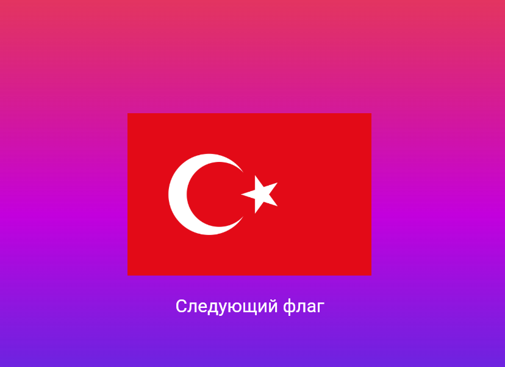

## Угадай флаг
### Нажав на кнопку "следующий флаг" появляется флаг и вы должны понять, какой именно это

ФИО: Донскова Ульяна Группа: ИСП-242 Дата: 25.10.2026

## Стек и версии
- Flutter: 3.47.6
- Dart: 3.13.5
- Платформа: Web Chrome
- IDE: vs code

## Скриншот приложения

## Структура проекта
background.dart - отвечает за фон 
flagi - отвечает за появление флагов
main - отвечает за включение приложения
text - отвечает за то, как выглядит текст
## Как запустить

- git clone <ссылка на репозиторий>
- cd <папка проекта>
- flutter pub get
- flutter run -d chrome

## Что изучили 

1. Как делать своё приложение
2. Как работать с картинками
3. Как работать с рандомными значениями
4. Как работать с несколькими файлами